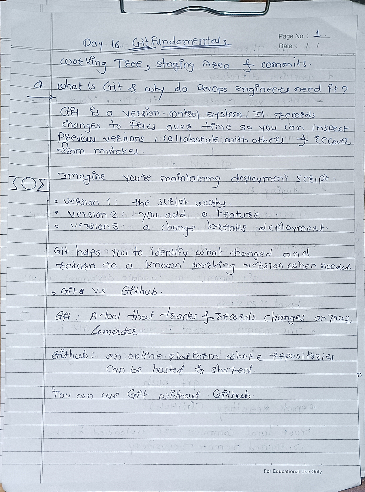
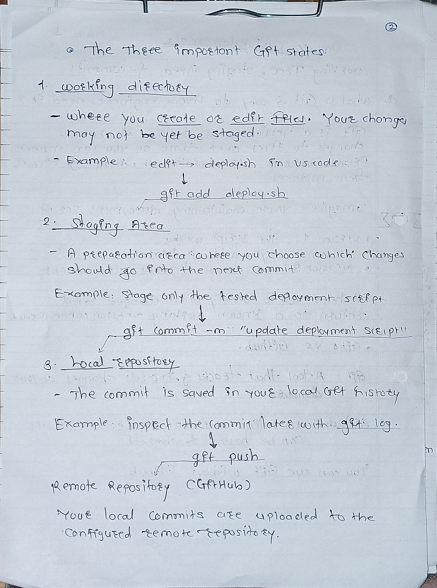
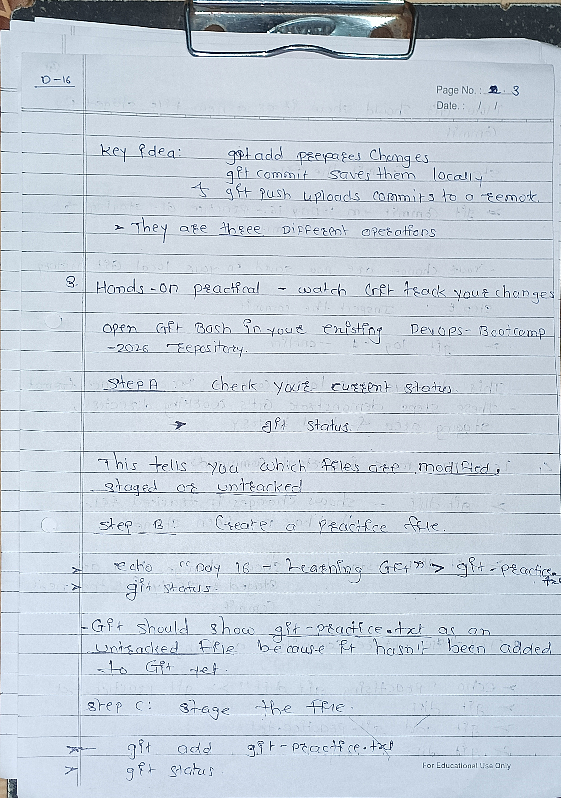
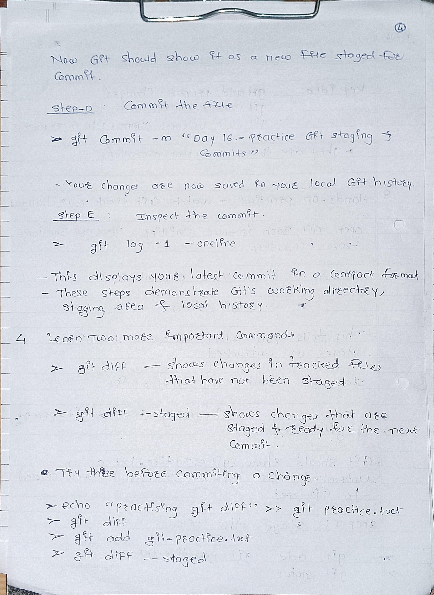

-----------------------------------------------------------------------------------------------------

# Day 16 — Git Fundamentals

## 1. What is Git?
Git is a version control system that tracks changes in files and helps us maintain project history.

## 2. Git vs GitHub
- **Git:** Tracks changes on our computer.
- **GitHub:** Stores Git repositories online and helps developers collaborate.

## 3. Three Main Areas of Git
- **Working Directory:** Where we create or modify files.
- **Staging Area:** Where we select changes for the next commit.
- **Local Repository:** Where Git stores committed changes and history.

## 4. Basic Git Workflow
Working Directory → Staging Area → Local Repository → GitHub

- `git add` — Stages changes.
- `git commit` — Saves staged changes in local Git history.
- `git push` — Uploads local commits to GitHub.

## 5. Important Git Commands

```bash
git status              # Check file status
git add notes.md        # Stage a file
git add .               # Stage changes in current directory
git diff                # View unstaged changes
git diff --staged       # View staged changes
git commit -m "message" # Commit staged changes
git log -1 --oneline    # View the latest commit
git push                # Upload commits to GitHub
```

## 6. Understanding Git Diff
- `git diff` shows changes that are not staged.
- `git diff --staged` shows changes that are staged but not yet committed.

## 7. Important Points
- `git add` does not create a commit.
- `git commit` saves changes locally; it does not automatically update GitHub.
- `git push` sends committed changes to the remote repository.
- Use `git status` to check your current changes before committing.

## 8. Day 16 Summary
Today I learned Git basics, the difference between Git and GitHub, the three main Git areas, and how to stage, review, commit, and push changes.

**Key workflow:** `git add` → `git diff --staged` → `git commit` → `git push`
