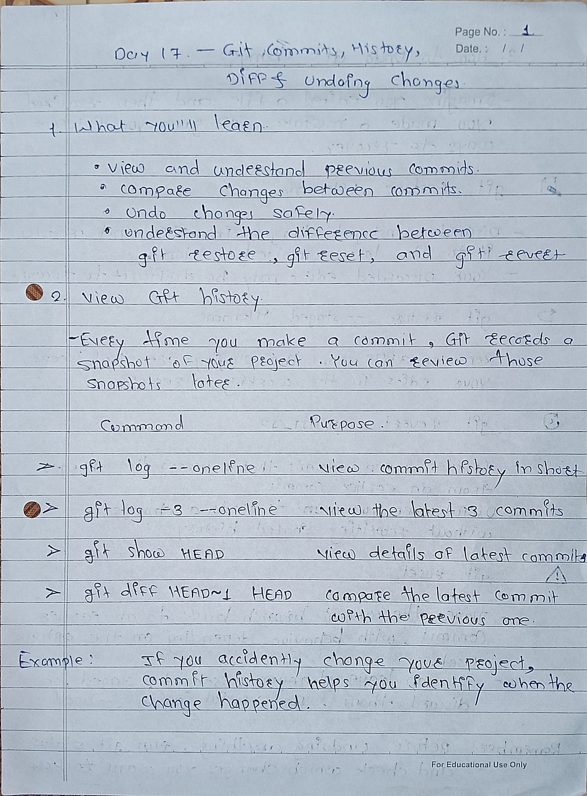
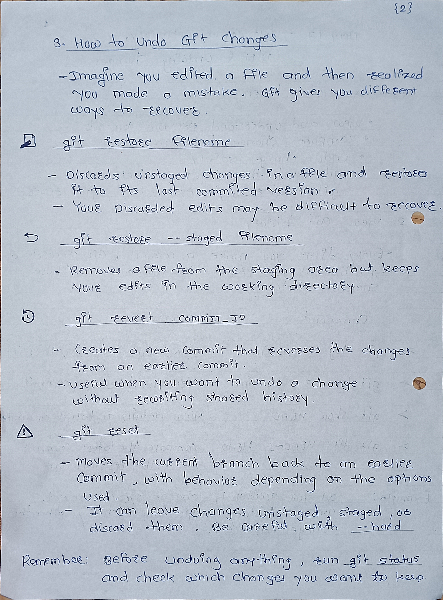
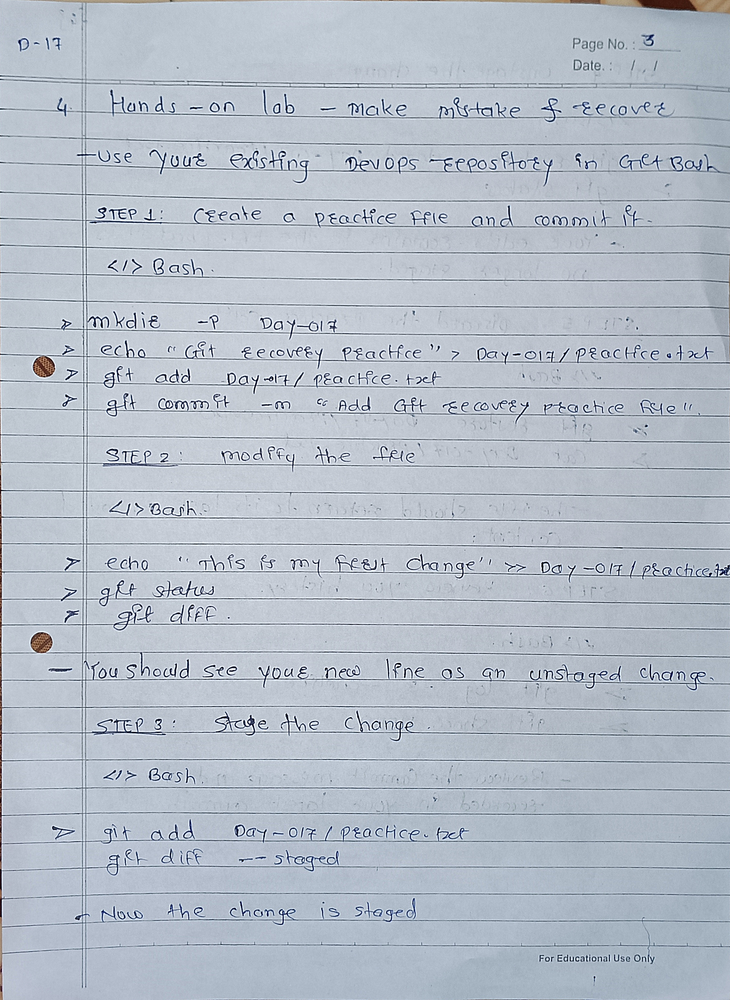
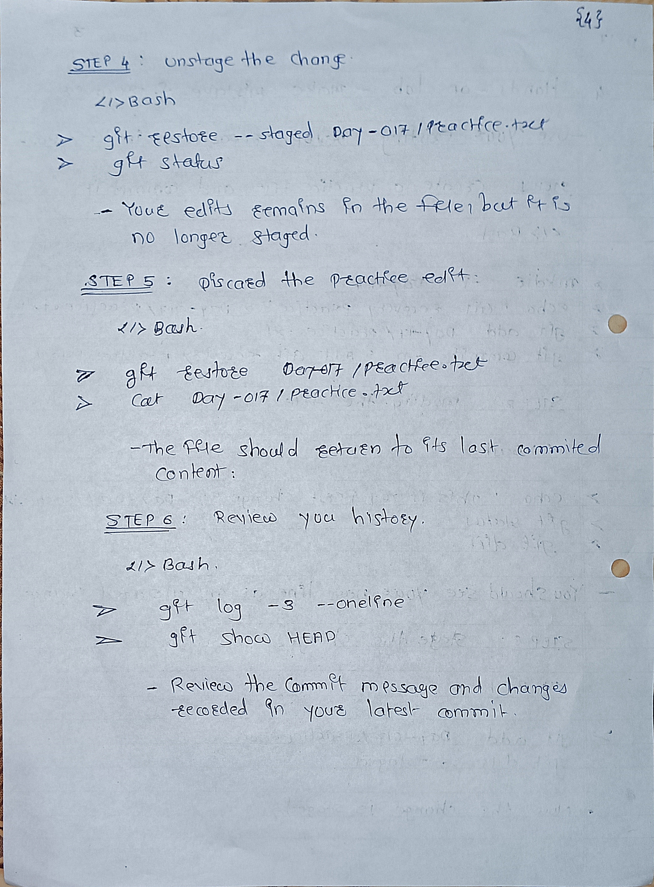

# Day 17 — Git History & Undoing Changes

## 1. Git History
Git history helps us see previous commits and understand what changes were made.

```bash
git log --oneline
git log -3 --oneline
git show HEAD
```

- `git log --oneline` — Shows commit history.
- `git log -3 --oneline` — Shows the latest 3 commits.
- `git show HEAD` — Shows details of the latest commit.

## 2. Comparing Changes

```bash
git diff HEAD~1 HEAD
```

Shows the differences between the latest commit and the previous commit.

## 3. Undoing Changes

**`git restore filename`** — Discards unstaged changes in a file.

**`git restore --staged filename`** — Unstages a file but keeps its edits.

**`git reset`** — Moves the current branch to an earlier commit. Its effect depends on the options used.

**`git revert COMMIT_ID`** — Creates a new commit that reverses an earlier commit.

## 4. Difference Between Reset and Revert

- **Reset = Go back.** Commonly used to undo local commits.
- **Revert = Create an undo commit.** Usually safer for changes already shared with teammates.

Example:

```bash
git reset --hard HEAD~1
```

Moves the branch back one commit and discards affected working-file changes. Use carefully.

```bash
git revert HEAD
```

Creates a new commit that reverses the latest commit.

## 5. Important Points
- Check `git status` before undoing changes.
- `git reset --hard` can permanently discard work.
- Prefer `git revert` when undoing a commit already shared on GitHub.
- Review commit history before making changes.

## 6. Day 17 Summary
Today I learned how to view Git history, compare commits, and undo changes using `git restore`, `git reset`, and `git revert`.