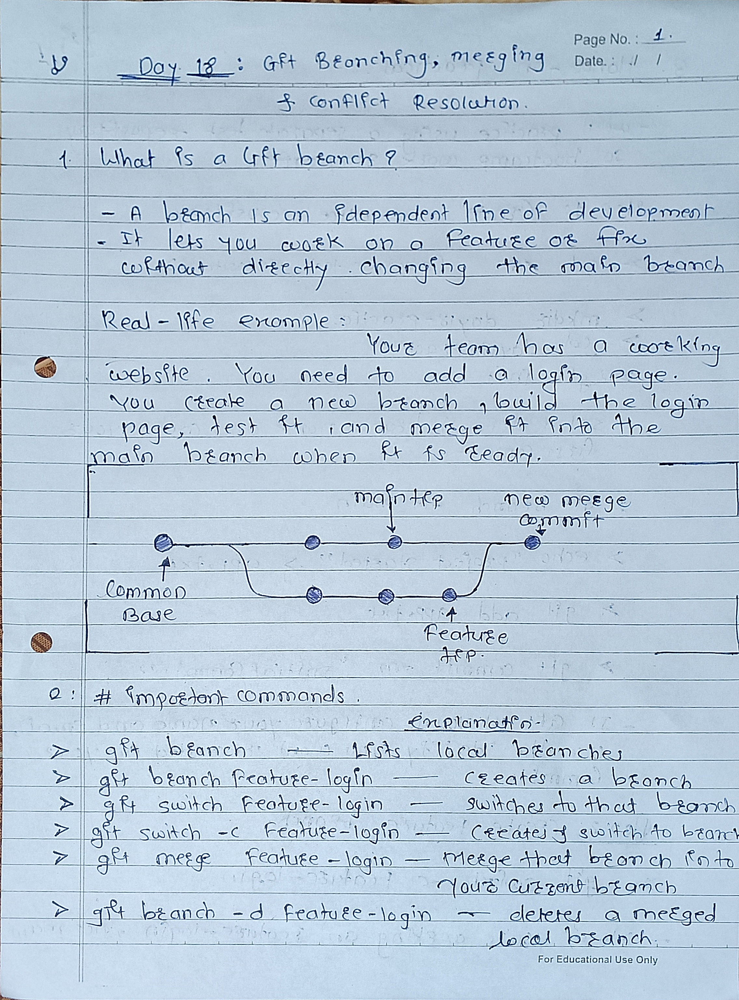
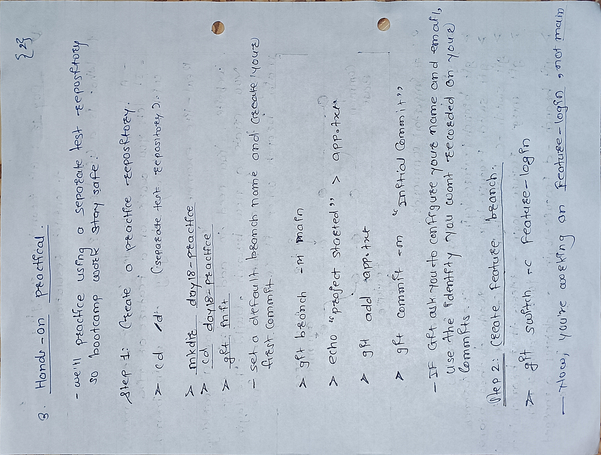
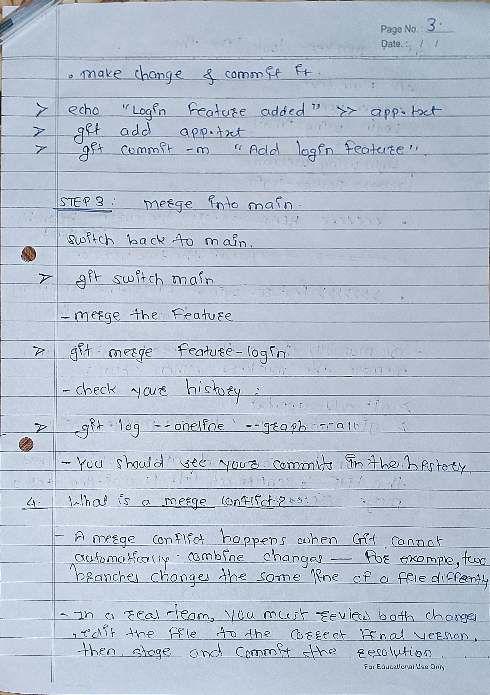
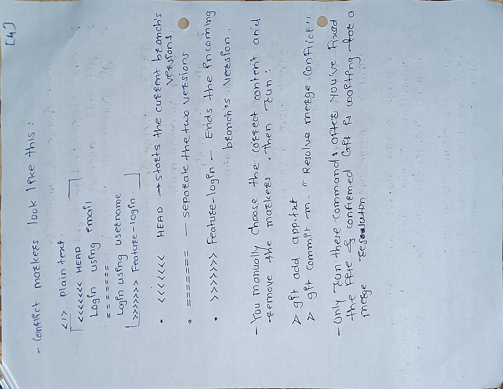

# Day 18 — Git Branching & Merging

## 1. What is a Git Branch?
A branch allows us to work on new features or fix bugs without directly changing the main branch.


## 3. What is Git Merging?
Merging combines changes from one branch into another.

Example:
```bash
git switch main
git merge feature-login
```
This merges `feature-login` into `main`.

## 4. What is a Merge Conflict?
A merge conflict happens when Git cannot automatically combine changes, often because two branches modify the same lines differently.

**How to resolve it:**
1. Open the conflicted file.
2. Choose or combine the correct changes.
3. Remove Git's conflict markers.
4. Save the file.
5. Run `git add filename`.
6. Complete the merge with `git commit` if Git requires it.

## 5. Important Points
- `main` is commonly used as the primary branch.
- Always check your current branch using `git branch`.
- Merge into the branch you want to update.
- Resolve conflicts carefully before completing a merge.
- Practice in a separate repository to keep your main project safe.

## 6. Day 18 Summary
Today I learned how to create and switch branches, merge changes, and understand and resolve Git merge conflicts.