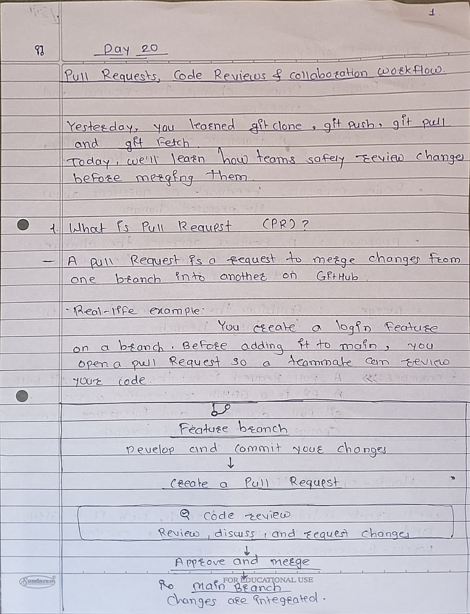
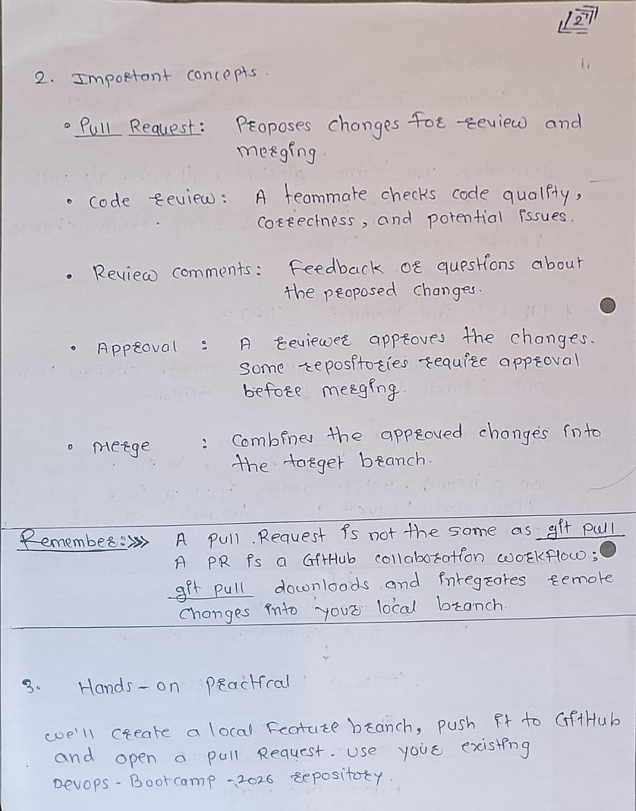
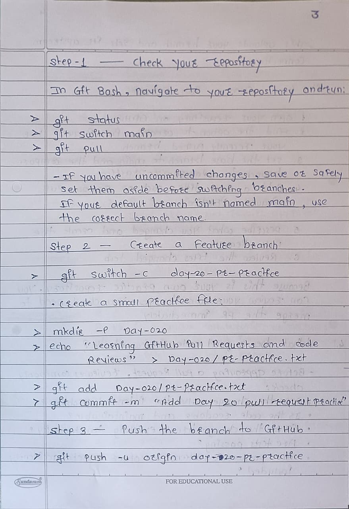
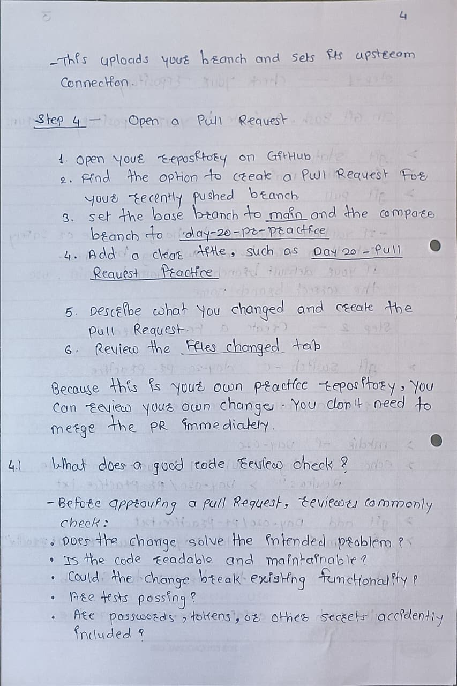

# Day 20 — Pull Requests & Code Reviews

## 1. What is a Pull Request (PR)?
A Pull Request is a request to review and merge changes from one branch into another on GitHub.

## 2. What is a Code Review?
A code review is when another developer checks your changes for mistakes, code quality, and possible improvements.

## 3. Pull Request Workflow
1. Create a feature branch.
2. Make changes and commit them.
3. Push the branch to GitHub.
4. Create a Pull Request.
5. Review the changes and discuss feedback.
6. Approve and merge the changes when ready.

## 4. Important Points
- A PR allows developers to review changes before merging.
- Code reviews help identify bugs and improve code quality.
- The **Files changed** tab shows what changed in a PR.
- `git pull` fetches and integrates remote changes locally.
- A Pull Request proposes changes for review and merging on GitHub.

## 5. Day 20 Summary
Today I learned how Pull Requests, code reviews, approvals, and merging help teams collaborate safely on GitHub.