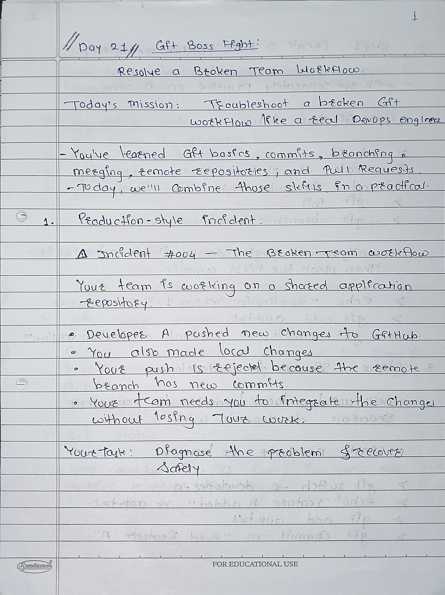
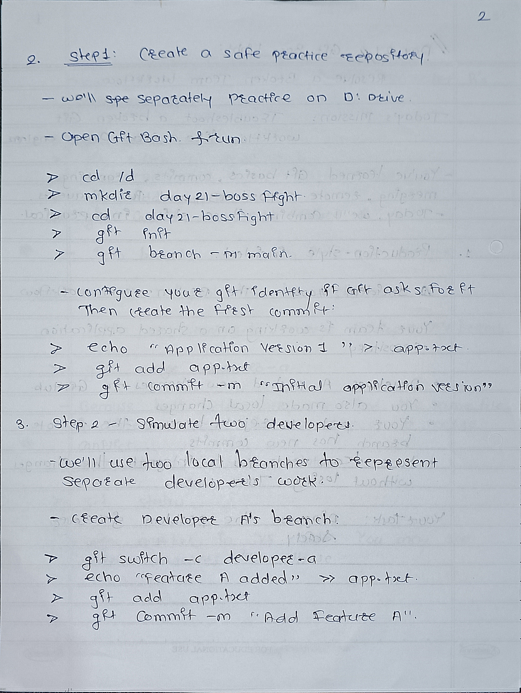
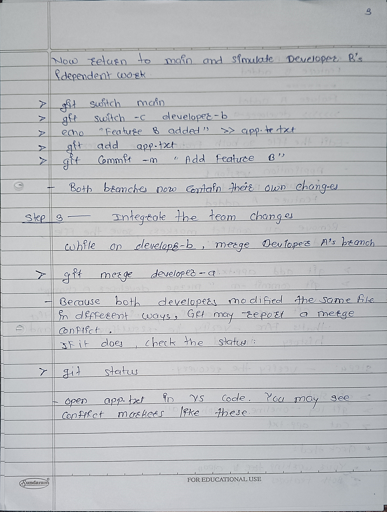
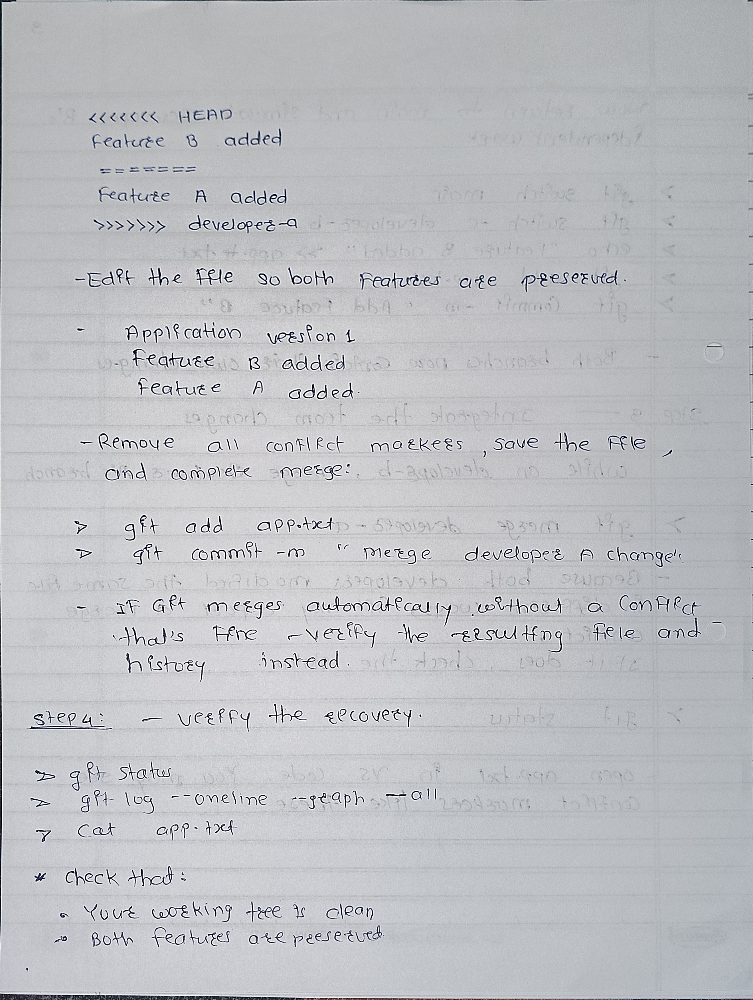

# Day 21 - Git Boss Fight Notes

## 1. Push Rejection
A push may be rejected when the remote branch has commits that are missing from the local branch.

## 2. Merge Conflict
A merge conflict happens when Git cannot automatically combine changes.

### Steps to Resolve
1. Open the conflicted file.
2. Review both changes.
3. Edit the file to keep the correct content.
4. Stage the resolved file.
5. Complete the merge if required.

## 3. View Git History
Use this command to see commits and branch relationships:

```bash
git log --oneline --graph --all
```

## Key Learning
Always review changes carefully before merging or pushing code.
