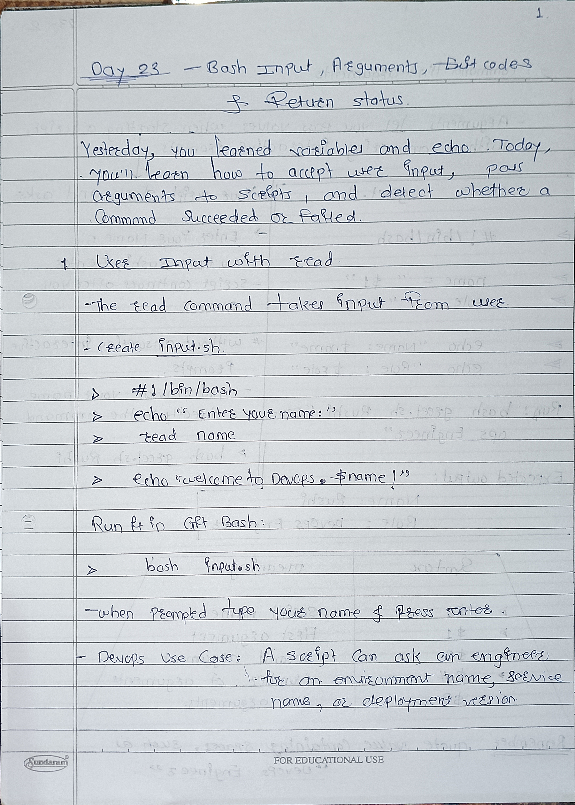
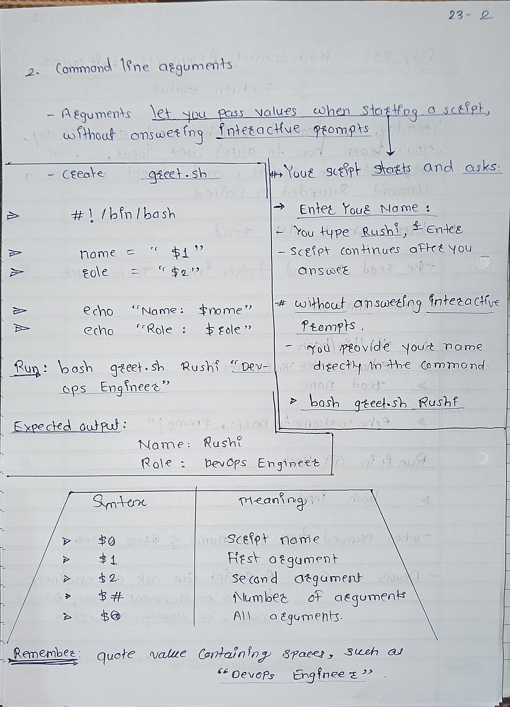
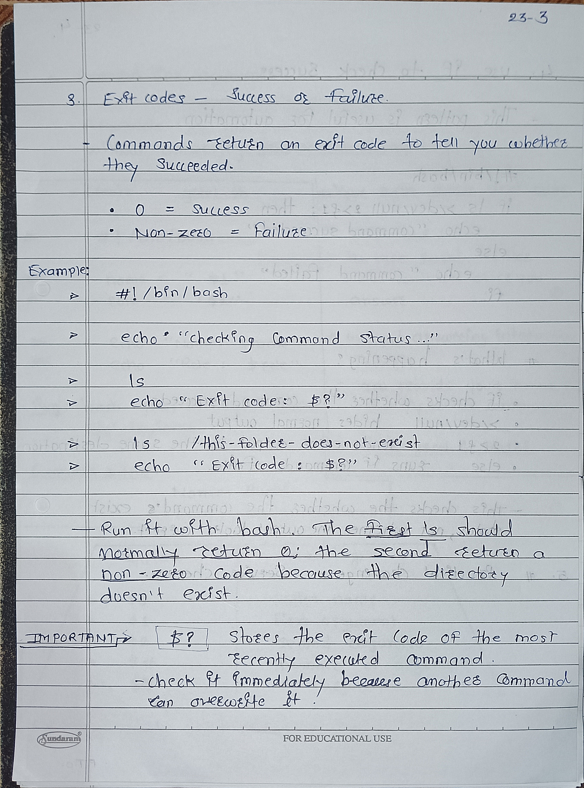
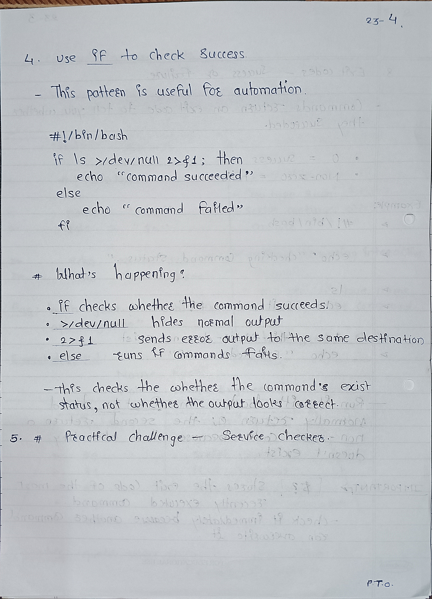
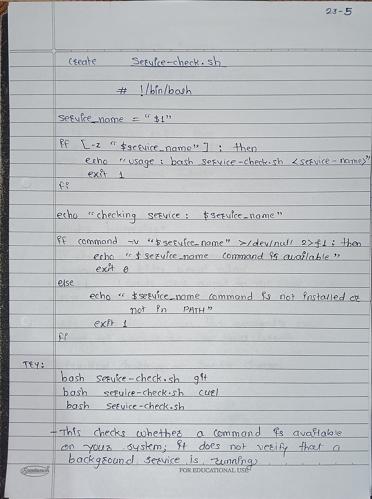

# Day 23 - Bash Scripting Notes

## 1. User Input
The `read` command accepts input from the user.

```bash
read name
echo "$name"
```

## 2. Command-Line Arguments
Arguments pass values to a script when it starts.

Example:
```bash
bash greet.sh Rushi
```

- `$0` - Script name
- `$1` - First argument
- `$2` - Second argument
- `$#` - Number of arguments
- `$@` - All arguments

## 3. Exit Codes
An exit code tells us whether a command succeeded.

- `0` - Success
- Non-zero - Failure or another status

## 4. Previous Exit Code
`$?` stores the exit code of the most recently executed command.

Example:
```bash
ls
echo $?
```

Check `$?` immediately after the command you want to check.

## 5. Exit Command
- `exit 0` - Exit successfully
- `exit 1` - Exit with a failure status

## 6. Conditional Check
An `if` statement can check whether a command succeeds.

```bash
if ls; then
    echo "Success"
else
    echo "Failed"
fi
```

## Key Learning
Arguments make scripts easier to reuse, and exit codes help automate error checking.
