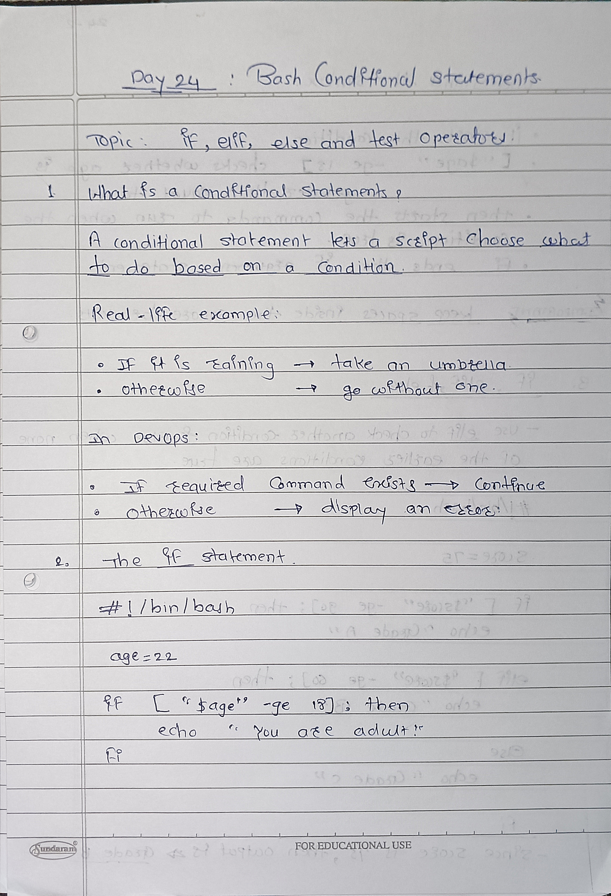
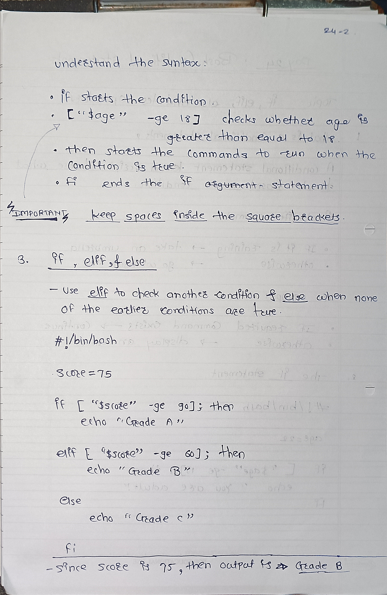
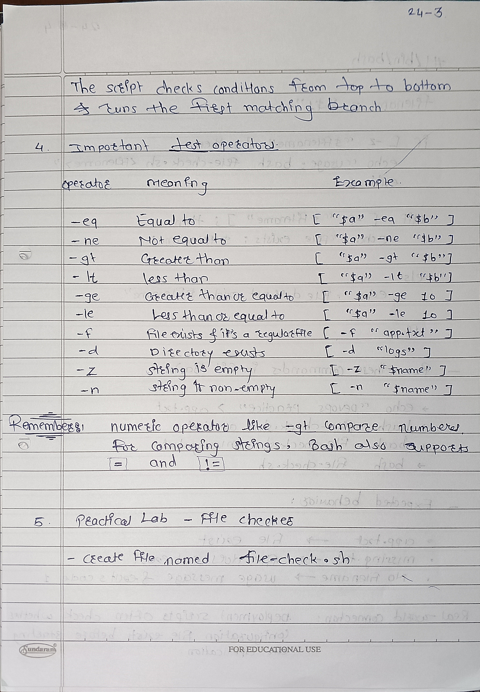
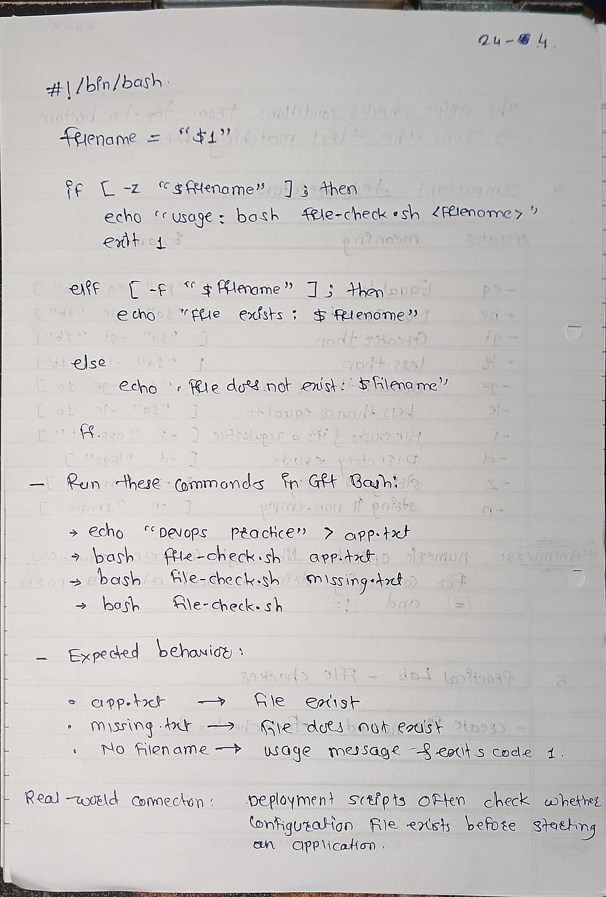

# Day 24 - Bash Conditional Statements Notes

## 1. What are conditions?
Conditions allow a script to make decisions based on whether something is true or false.

## 2. if, elif, else
- `if` checks the first condition.
- `elif` checks another condition.
- `else` runs when no earlier condition is true.
- `fi` ends the conditional statement.

## 3. Numeric Operators
- `-eq` : Equal to
- `-ne` : Not equal to
- `-gt` : Greater than
- `-lt` : Less than
- `-ge` : Greater than or equal to
- `-le` : Less than or equal to

## 4. File and String Operators
- `-f` : Checks whether a regular file exists.
- `-d` : Checks whether a directory exists.
- `-z` : Checks whether a string is empty.
- `-n` : Checks whether a string is non-empty.

## 5. Example
```bash
if [ -f "app.txt" ]; then
    echo "File exists"
else
    echo "File does not exist"
fi
```

## Key Learning
Conditions help DevOps scripts check files, validate input, and handle errors.
