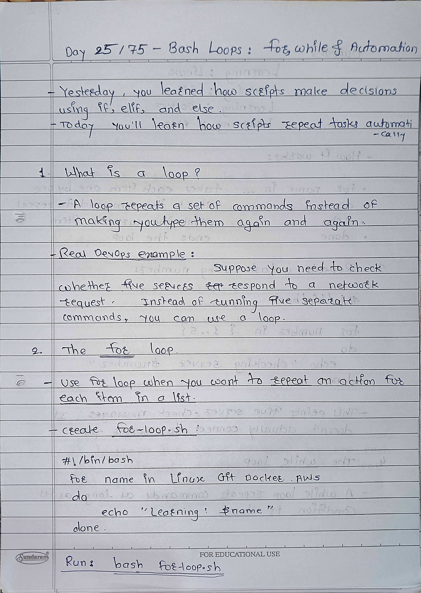
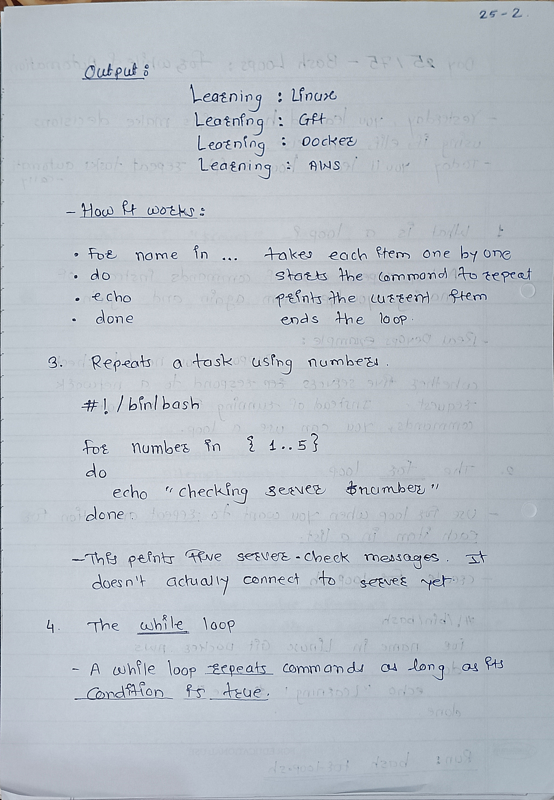
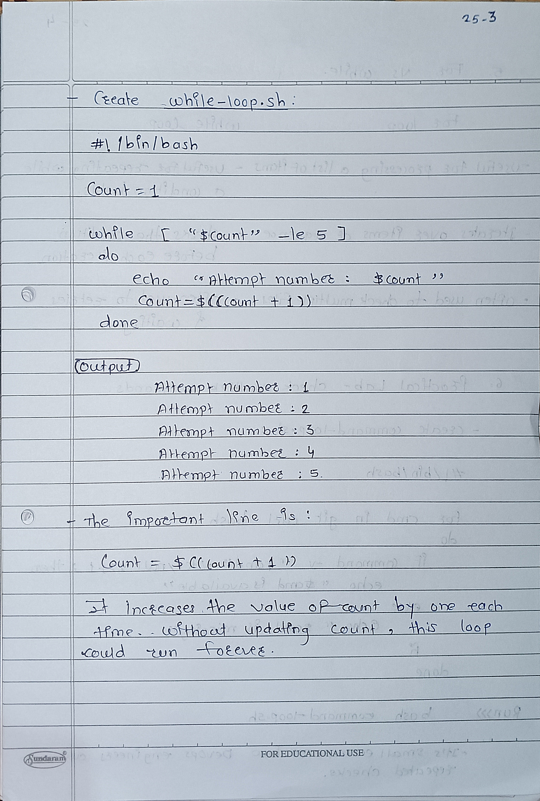
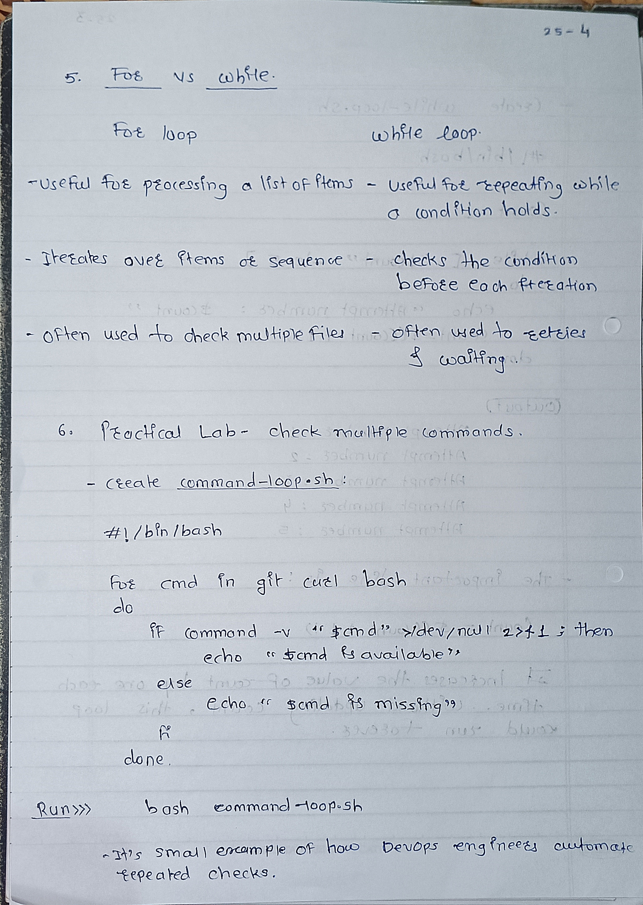

# Day 25: Bash Loops Notes

## 1. What is a loop?
A loop repeats commands automatically.

## 2. For Loop
Used when you want to repeat something for a list of values.

```bash
for i in 1 2 3 4 5
do
    echo "$i"
done
```

## 3. While Loop
Repeats commands while a condition is true.

```bash
count=1

while [ "$count" -le 5 ]
do
    echo "$count"
    count=$((count + 1))
done
```

## 4. Important Keywords
- `for`: Starts a for loop.
- `while`: Starts a while loop.
- `do`: Starts the loop's commands.
- `done`: Ends the loop.
- `count=$((count + 1))`: Increases the counter by 1.

## 5. Infinite Loop
A loop that never stops because its stopping condition is never reached.

**Remember:** Always check your loop condition and update your counter when needed.

## Real-World Use
Loops can check multiple servers, process files, or repeat health checks automatically.
